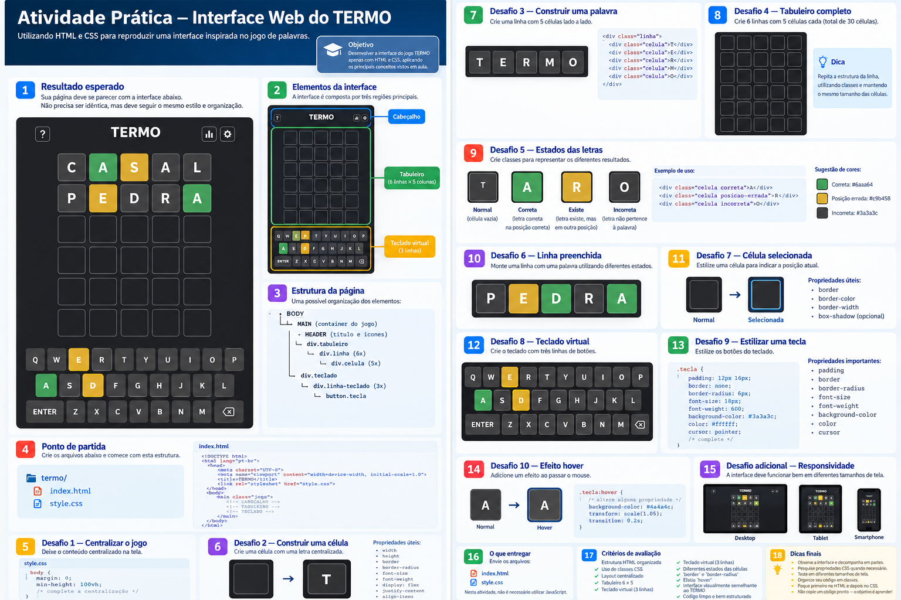

# Atividade Prática — Interface Web do TERMO

## Objetivo

Nesta atividade você deverá desenvolver, utilizando **HTML e CSS**, uma interface inspirada no jogo de palavras **TERMO**.

> **Nesta etapa não é necessário implementar a lógica do jogo em JavaScript. Fica para próxima.**

O objetivo é praticar a capacidade de **observar uma interface, identificar seus componentes e reproduzi-los utilizando HTML e CSS**.

---

## Resultado esperado

Use a imagem abaixo como **referência visual**. Sua interface não precisa ser uma cópia pixel a pixel, mas deve manter a mesma organização geral.



---

# 1. Antes de programar: decomponha a interface

Observe que a aplicação pode ser dividida em três grandes regiões:

```text
┌─────────────────────────────────────┐
│               TERMO                 │  ← CABEÇALHO
├─────────────────────────────────────┤
│                                     │
│       □   □   □   □   □             │
│       □   □   □   □   □             │
│       □   □   □   □   □             │  ← TABULEIRO
│       □   □   □   □   □             │
│       □   □   □   □   □             │
│       □   □   □   □   □             │
│                                     │
├─────────────────────────────────────┤
│    Q W E R T Y U I O P              │
│     A S D F G H J K L               │  ← TECLADO
│       Z X C V B N M                 │
└─────────────────────────────────────┘
```

Uma possível estrutura:

```text
BODY
 └── MAIN
      ├── HEADER
      │    └── TÍTULO
      ├── TABULEIRO
      │    ├── LINHA
      │    │    ├── CÉLULA
      │    │    ├── CÉLULA
      │    │    ├── CÉLULA
      │    │    ├── CÉLULA
      │    │    └── CÉLULA
      │    └── ...
      └── TECLADO
           ├── LINHA
           ├── LINHA
           └── LINHA
```

**Pergunta:** quais elementos HTML podem representar cada uma dessas partes?

---

# 2. Ponto de partida

Crie:

```text
termo/
├── index.html
└── style.css
```

Comece o `index.html` com:

```html
<!DOCTYPE html>
<html lang="pt-br">

<head>
    <meta charset="UTF-8">

    <meta
        name="viewport"
        content="width=device-width, initial-scale=1.0"
    >

    <title>Jogo de Palavras</title>

    <link
        rel="stylesheet"
        href="style.css"
    >
</head>

<body>

    <main class="jogo">

        <!-- CABEÇALHO -->


        <!-- TABULEIRO -->


        <!-- TECLADO -->

    </main>

</body>
</html>
```

A partir desse ponto, você deverá construir a interface.

---

# 3. Desafio 1 — Centralizar o jogo

Queremos que a aplicação fique centralizada na página.

Pesquise sobre:

```css
display: flex;
justify-content: center;
align-items: center;
min-height: 100vh;
```

Comece:

```css
body {
    margin: 0;
    min-height: 100vh;

    /* complete */
}
```

**Pergunta:** qual propriedade transforma o `body` em um Flex Container?

---

# 4. Desafio 2 — Construa uma célula

Antes de criar o tabuleiro completo, faça **apenas uma célula**:

```text
┌─────────┐
│         │
│    T    │
│         │
└─────────┘
```

Pesquise:

```text
width
height
border
border-radius
font-size
font-weight
```

Depois resolva outro problema:

> Como centralizar a letra horizontal e verticalmente dentro da célula?

**Dica:** uma célula também pode ser um **Flex Container**.

---

# 5. Desafio 3 — Construa uma palavra

Transforme:

```text
T E R M O
```

em:

```text
┌───┐ ┌───┐ ┌───┐ ┌───┐ ┌───┐
│ T │ │ E │ │ R │ │ M │ │ O │
└───┘ └───┘ └───┘ └───┘ └───┘
```

Uma possível estrutura:

```html
<div class="linha">

    <div class="celula">T</div>
    <div class="celula">E</div>
    <div class="celula">R</div>
    <div class="celula">M</div>
    <div class="celula">O</div>

</div>
```

Pesquise:

```text
display: flex
gap
```

---

# 6. Desafio 4 — Construa o tabuleiro

Agora repita a estrutura.

O tabuleiro deverá possuir:

```text
          5 COLUNAS
              ↓
        □ □ □ □ □
        □ □ □ □ □
        □ □ □ □ □
        □ □ □ □ □
        □ □ □ □ □
        □ □ □ □ □
        ↑
      6 LINHAS
```

Portanto:

**6 linhas × 5 células = 30 células.**

---

# 7. Desafio 5 — Estados das letras

Crie classes CSS diferentes para representar os estados das letras.

Sugestão:

```css
.correta {

}

.posicao-errada {

}

.incorreta {

}
```

Exemplo de uso:

```html
<div class="celula correta">A</div>

<div class="celula posicao-errada">R</div>

<div class="celula incorreta">T</div>
```

Pesquise:

```text
background-color
color
border-color
```

A interface deverá comunicar visualmente:

```text
CORRETA
→ letra correta na posição correta

POSIÇÃO ERRADA
→ letra existe, mas está em outra posição

INCORRETA
→ letra não pertence à palavra
```

---

# 8. Desafio 6 — Crie uma tentativa preenchida

Faça pelo menos uma linha apresentar uma palavra.

Exemplo:

```text
┌───┐ ┌───┐ ┌───┐ ┌───┐ ┌───┐
│ P │ │ E │ │ D │ │ R │ │ A │
└───┘ └───┘ └───┘ └───┘ └───┘
```

Aplique diferentes classes às células.

Observe a relação:

```text
HTML
define a célula

        +

CLASS
define o estado

        +

CSS
define sua aparência
```

---

# 9. Desafio 7 — Célula selecionada

Crie uma classe para indicar a posição atual:

```css
.selecionada {

}
```

Visualmente:

```text
NORMAL                   SELECIONADA

┌─────┐                  ╔═════╗
│     │                  ║     ║
└─────┘                  ╚═════╝
```

Pesquise:

```text
border
border-color
border-width
box-shadow
```

---

# 10. Desafio 8 — Construa o teclado virtual

Crie três linhas de botões.

Primeira:

```text
Q W E R T Y U I O P
```

Segunda:

```text
A S D F G H J K L
```

Terceira:

```text
Z X C V B N M
```

Utilize elementos:

```html
<button>Q</button>
```

Uma possível estrutura:

```html
<div class="teclado">

    <div class="linha-teclado">
        <!-- teclas -->
    </div>

    <div class="linha-teclado">
        <!-- teclas -->
    </div>

    <div class="linha-teclado">
        <!-- teclas -->
    </div>

</div>
```

---

# 11. Desafio 9 — Estilize as teclas

Seu CSS deverá considerar propriedades como:

```text
padding
border
border-radius
font-size
font-weight
background-color
color
cursor
```

Comece:

```css
.tecla {

    /* complete */

}
```

---

# 12. Desafio 10 — Adicione `hover`

Queremos indicar visualmente que as teclas são elementos interativos.

```css
.tecla:hover {

    /* complete */

}
```

Experimente:

```text
background-color
color
border
transform
```

Exemplo conceitual:

```text
NORMAL
   │
   │ mouse
   ↓
HOVER
```

---

# 13. Desafio adicional — Transição

O efeito `hover` não precisa acontecer de forma brusca.

Pesquise:

```css
transition
```

Experimente combinar:

```css
.tecla {
    transition: ...;
}

.tecla:hover {
    transform: ...;
}
```

---

# 14. Desafio adicional — Responsividade

Reduza o tamanho da janela.

Pergunte:

```text
Minha interface funciona em:

Desktop?
Notebook?
Smartphone?
```

Pesquise:

```text
width
max-width
%
vw
media queries
```

A interface não deve funcionar apenas no tamanho de tela utilizado durante o desenvolvimento.